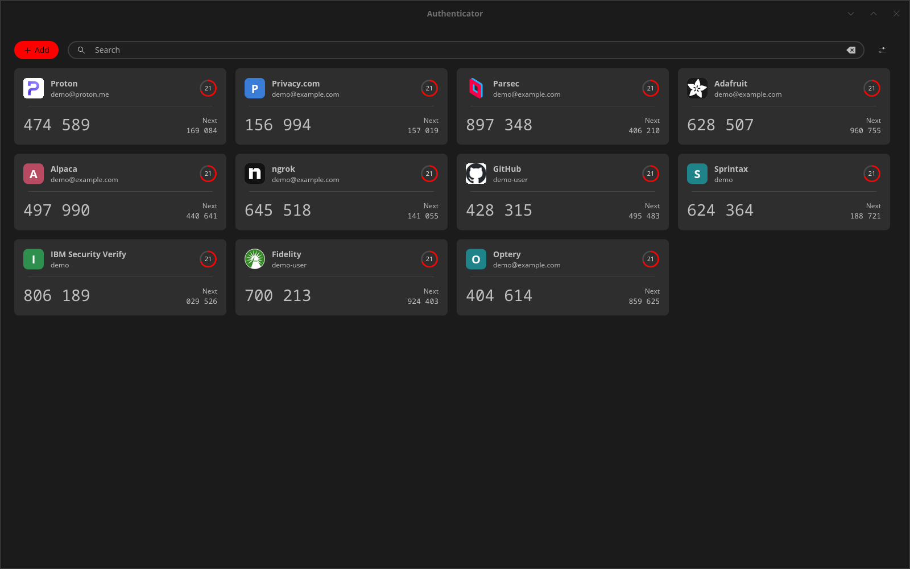

# cosmic-authenticator

Native COSMIC (libcosmic) app for two-factor codes, built on Proton Authenticator's
open-source Rust core (`proton-authenticator` in protonpass/proton-pass-common,
GPL-3.0). Code generation, imports, exports and entry encryption all come from
that core.

Not an official Proton app.

## Install

**One click:** open [the install file](https://nilltadios.github.io/cosmic-authenticator/dev.nilltadios.CosmicAuthenticator.flatpakref) in COSMIC Store, Discover or GNOME Software.

**Terminal:**

```sh
flatpak remote-add --user --if-not-exists flathub https://dl.flathub.org/repo/flathub.flatpakrepo
flatpak remote-add --user --if-not-exists cosmic-authenticator https://nilltadios.github.io/cosmic-authenticator/cosmic-authenticator.flatpakrepo
flatpak install --user cosmic-authenticator dev.nilltadios.CosmicAuthenticator
```

Updates arrive through `flatpak update`, COSMIC Store, Discover or GNOME Software like any other app. Every push to `main` builds, signs and publishes a new version ([workflow](.github/workflows/flatpak.yml)).

**Installed it from a downloaded `.flatpak` file?** That copy never updates. Add the remote (second command above), then switch to it. Your codes and settings are kept:

```sh
flatpak install --user --reinstall cosmic-authenticator dev.nilltadios.CosmicAuthenticator
```

Use `--system` instead of `--user` in every command if you installed it system-wide.

**Signing key fingerprint:** `8402 3450 4490 3206 B410  E737 EFC3 7D07 A14D A863`. To compare it with the key the site serves:

```sh
curl -s https://nilltadios.github.io/cosmic-authenticator/cosmic-authenticator.flatpakrepo | sed -n 's/^GPGKey=//p' | base64 -d | gpg --show-keys
```

## Goal

The official Proton Authenticator desktop app, with every feature kept, but a
native UI in place of its WebKit one. In September 2026 the official app idled
at about 25% CPU and 1.3 GB of memory, almost all of it from the web front end
redrawing the countdown rings. The target is feature parity, including sign-in
and sync with a Proton account. Sign-in and one-way sync are built (see
[Proton sync](#proton-sync)); two-way sync is next.



## Build, run, install

```bash
cargo build --release
./target/release/cosmic-authenticator
./install.sh        # binary to ~/.local/bin, plus desktop entry and icon
cargo test --release
```

### Flatpak

```bash
flatpak/build.sh
flatpak install --user flatpak/dev.nilltadios.CosmicAuthenticator.flatpak
flatpak run dev.nilltadios.CosmicAuthenticator
flatpak uninstall --user dev.nilltadios.CosmicAuthenticator   # to remove it
```

`build.sh` vendors the crates (pinned by `Cargo.lock`), then builds offline
with `flatpak-builder` on the GNOME 51 runtime (for the sign-in window's WebKit),
with the official Rust release pinned in `rust-toolchain.toml`, and exports a single-file bundle. The app runs as
a native Wayland client, with X11 only as a fallback where there is no Wayland.
Its sandbox allows network (logos), the Secret Service keyring (the vault key),
read-only `~/.config/cosmic` (the theme) and files only through the file chooser.
The Flatpak keeps its vault in `~/.var/app/dev.nilltadios.CosmicAuthenticator`,
separate from the native build's; move codes between them with export and import.

The default build draws with the GPU (libcosmic's `wgpu` renderer). Measured
with `demo/measure.sh 60` on a 2560×1440 monitor on 2026-09-25, it idled at 0.2%
of one core and 86 MB, against 6.1% and 64 MB for the software renderer, and it
scrolls and resizes smoothly where the software renderer lagged.
The software renderer is still built in as a fallback: at startup the app tries
the GPU and switches to software if the GPU renderer cannot start. To force one,
set `ICED_BACKEND=tiny-skia` (software) or `ICED_BACKEND=wgpu`, for the Flatpak
with `flatpak run --env=ICED_BACKEND=tiny-skia dev.nilltadios.CosmicAuthenticator`.
`cargo build --release --no-default-features` builds a software-only binary.

It follows the COSMIC theme in `~/.config/cosmic` (accent colour, light or dark).
Outside COSMIC, where the COSMIC icon theme is usually missing, it uses the
desktop's icon theme (KDE's, then GTK's, then Breeze or Adwaita).

### Updating

`flatpak/release.sh` releases a new version to the installed Flatpak. It raises
the version, runs the tests, builds, commits, and updates the app from the local
repository `flatpak/repo`. That repository is added once as the `cosmicauthenticator`
remote, so `flatpak update` can reach the app (a bundle install cannot):

```bash
flatpak remote-add --user --no-gpg-verify cosmicauthenticator "file://$PWD/flatpak/repo"
flatpak install --user --reinstall cosmicauthenticator dev.nilltadios.CosmicAuthenticator
flatpak/release.sh 0.3.0
```

The reinstall keeps the vault, app lock and Proton session.

`./check-upstream.sh` compares the official app's version (from Proton's update
feed) with the one this app sends to Proton, and the pinned Proton core and
libcosmic with their upstream versions. When Proton releases a new version of the
official app, port its changes before raising `APP_VERSION` in
`src/proton/api.rs`. Proton eventually refuses old versions; the app then says
sync is paused until it is updated.

## Using it

- **Copy a code:** click its card. Right-click for *Copy next code*, *Edit* and *Delete*.
- **Reorder:** drag a card. Dragging is off while a search is active.
- **Add** opens a menu:
  - *Enter a setup key*: title, secret and issuer, plus digits, time interval,
    algorithm and TOTP or Steam under *Advanced options*. Pasting an `otpauth://`
    link into the secret field fills in the whole form.
  - *Scan QR code image…*: a screenshot or saved image of a setup QR code,
    including Google Authenticator's export QR codes.
  - *Paste otpauth:// link* from the clipboard.
  - *Import from another app…*
- **Settings** (the button at the right of the search bar): hide codes, service
  logos on or off, theme, import and export.
- **Keys:** Ctrl+F search, Ctrl+N add, Ctrl+O import, Ctrl+V paste a link,
  Ctrl+, settings, Escape closes the open menu, dialog or panel.

The countdown ring turns to the warning colour at 10 seconds and the danger
colour at 5, as in Proton's apps.

## Proton sync

*Settings → Sync between devices* signs in to a Proton account the way the
official app does: a small window on Proton's account site, where Proton
handles the password, 2FA and CAPTCHA. The app then downloads and decrypts the
account's codes. *Create one* opens Proton's sign-up page instead.

This version syncs one way. Codes from Proton appear here and follow changes
made on other devices, but they cannot be edited or deleted here, and codes
added here stay on this device. Two-way sync comes next.

- The session (tokens and the key password that unlocks the account keys) is
  kept in the Secret Service keyring as `proton-session`.
- `$XDG_DATA_HOME/cosmic-authenticator/sync.json` records which local code is
  which Proton entry (ids and revisions only).
- Turning sync off ends the session on Proton; the codes stay on this device.
- To Proton's servers the app presents itself as the official Linux client.
- The sign-in window is a separate program, `cosmic-authenticator-login`
  (in `login/`), so the app itself never loads a web engine. It needs
  WebKitGTK 6.0; the Flatpak includes it.

How the official app signs in and syncs, with sources, is in
[docs/proton-sync.md](docs/proton-sync.md).

## App lock

*Settings → Security → App lock* works as in the official app on Linux: None
or Password (the official app's biometrics option is not available on Linux).
With a password, Authenticator asks for it every time it starts, and nothing
is decrypted until it is entered.

- The password goes through Argon2id with Proton's parameters (1 pass, 4
  lanes, 512 MiB of memory, so unlocking takes a second or two). The result is
  the key for the vault and for the saved Proton session; the keyring key is
  removed, so the keyring alone no longer opens them.
- After 10 wrong passwords in a row, the codes on this device, the sync state
  and the Proton session are erased, as the official app does. Codes from
  Proton come back after signing in again; codes that exist only on this
  device are lost.
- Turning the lock off asks for the current password.
- The password is never stored, and it does not stay in memory: typed
  passwords, the derived key, the vault key and the Proton key password are
  held in types that wipe themselves when dropped (`zeroize`) and never print
  (`Secret(…)`, `Key(…)`), and Argon2 and AES wipe their working memory.
  `uv run --no-project demo/secret-test.py` checks this: it locks and unlocks
  with a test password, then searches the running app's memory (thread stacks
  included), its files and its keyring entries for the password. Checks that
  the password *is* found while still typed prove the search can see it.
- `--import` refuses to run while the lock is on; import from within the app.

## Importing

The format is detected from the file, so one *Import* covers Proton
Authenticator (plain or password-protected), Proton Pass (`.zip`), Aegis (plain
or encrypted JSON, or text), 2FAS (plain or encrypted), Bitwarden (JSON or CSV),
Ente (text or encrypted), LastPass, Google Authenticator export QR codes, and
lists of `otpauth://` links. Codes already in the list are skipped. HOTP codes
are not supported, and are counted as such.

From the command line (password-protected exports read the password from
`AUTHENTICATOR_EXPORT_PASSWORD`):

```bash
./target/release/cosmic-authenticator --import path/to/export.json
```

Delete plain export files after importing them.

## Exporting

*Settings → Export…* writes a Proton Authenticator export, which Proton's apps
and this one can import. With a password it is encrypted; without one, anyone
with the file can copy every code. The file is written readable by you only.

## Storage

- Vault: `$XDG_DATA_HOME/cosmic-authenticator/vault.json` (mode 0600). Each entry is
  encrypted separately with Proton's `encrypt_entries` (AES-GCM).
- Key: Secret Service keyring, service `dev.nilltadios.CosmicAuthenticator`, stored as
  Base64 text because KDE rejects binary secrets that `keyring` 3.x labels as text.
- Settings: `$XDG_CONFIG_HOME/cosmic-authenticator/settings.json` (nothing secret).
- Logos: `$XDG_CACHE_HOME/cosmic-authenticator/logos`. With *Service logos* on,
  each logo is downloaded once from the address in Proton's issuer list, usually
  the service's own site or Google's favicon service, as Proton Authenticator
  does. Turning it off stops all network access.

## Differences from Proton's core

- A new or changed TOTP secret must be Base32. Proton's generator falls back to
  a secret's raw bytes when it is not, so a mistyped key would otherwise give
  wrong codes without any error. Imported secrets are kept as they are.
- QR codes are read with `rqrr`. Proton's `qr` feature uses `rxing` 0.9, which
  pins `image` 0.25.8, older than libcosmic accepts.

## Demo data, screenshots and measurements

`demo/demo-export.json` holds 11 entries with random, fake secrets, and
`demo/demo-qr.png` is a QR code of a fake link (made by `demo/make-demo-qr.py`).

```bash
demo/screenshots.sh           # every view, into demo/screenshots (needs sway and grim)
demo/measure.sh 60            # idle CPU and memory of the release build
demo/measure.sh 60 --flatpak  # the same for the installed Flatpak
demo/measure-running.sh 60    # the copy already running, without restarting it (CPU, PSS, GPU time)
demo/lock-test.sh             # the app lock, end to end, with checks
uv run --no-project demo/secret-test.py  # the lock password is not left in memory, files or keyring
```

`screenshots.sh` runs the app in a headless sway session, so the windows do not
take focus on the desktop while it works. It builds with `--features preview`,
which lets `AUTHENTICATOR_PREVIEW=<view>` open a menu, panel or dialog at
startup, since headless sway has no pointer to click with.

`measure.sh` runs on the current desktop session, where the window opens for the
length of the run. It sums CPU time and PSS memory over the whole process tree,
so it can measure any app the same way, for example
`demo/measure.sh 60 flatpak run <app-id>`. The Flatpak's D-Bus proxy runs outside
that tree and is not counted.

| Measured 2026-09-25 with `demo/measure.sh 60`, KDE Plasma (Wayland), 11 codes | Processes | CPU (one core) | Memory (PSS) |
|---|---|---|---|
| Software renderer, 2560×1440 monitor | 1 | 6.1% | 64 MB |
| GPU renderer (now the default), 2560×1440 monitor | 1 | 0.2% | 86 MB |
| Installed Flatpak (GPU), the user's own running copy, `demo/measure-running.sh 60` | 3 | 0.2% | 93 MB |
| Software renderer, release build, default window on the laptop screen | 1 | 2.6% | 38 MB |
| Software renderer, Flatpak, default window on the laptop screen | 3 | 2.6% | 44 MB |

Each row is a single 60-second run. The software renderer redraws the whole
window on the CPU every second, so its cost grows with window size; PSS does
not count the GPU's own memory.

Only numbers from the same script on the same machine compare. The prototype was
measured on 2026-09-24 on a different install (about 1.6% CPU and 62 MB RSS,
against about 25% and 1.3 GB for Proton Authenticator 1.1.6's Flatpak), and those
figures do not compare with the table.

## Not done

In the order they are planned, to match the official app:

1. Two-way sync: create, edit, delete and reorder on Proton.
2. Automatic backups, digit style (plain or boxed),
   animated code changes, a warning when the storage key is not in the keyring,
   and help links.
